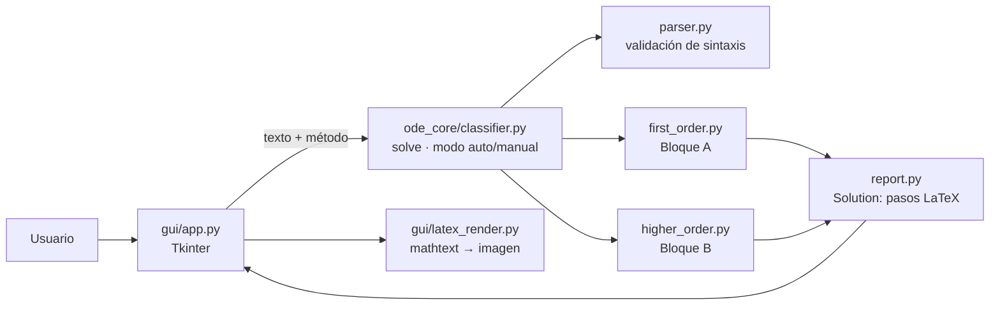

# Calculadora de EDO (analítica, con GUI)

Resuelve EDO de **primer orden** (Bloque A) y **orden superior** (Bloque B) paso a paso, con la solución y la trazabilidad en notación matemática (LaTeX renderizado). La lógica de cada método está programada en `ode_core`; sympy solo integra, deriva, simplifica y calcula raíces (nunca `dsolve`).

## Ejecutar
```
pip install -r requirements.txt
python main.py
```
Pruebas del motor (verifican cada solución sustituyéndola en la EDO): `python -m tests.test_engine`

## Manual de uso
1. **Modo automático**: escriba la ecuación y pulse *Resolver*. El sistema clasifica, **activa el método en el menú** y muestra qué métodos descartó y por qué.
2. **Modo manual**: elija el método en el menú. Debajo aparece el formato requerido y un ejemplo (*Cargar ejemplo*). Si la ecuación no cumple el formato, se muestra una alerta con el motivo.
3. Sintaxis: `y'`, `y''`, `y'''`, `dy/dx`, `d2y/dx2`; forma diferencial `M(x,y) dx + N(x,y) dy = 0`; `*` para multiplicar, `^` para potencias; `exp, sin, cos, tan, ln, sqrt, pi, e`. Botones *Insertar* para escribirlos rápido.
4. Resultado: **Solución** arriba (y_c, y_p, y), **Clasificación** y **Trazabilidad** (derivadas parciales, factor integrante, raíces de la ecuación auxiliar, y_c / y_p por separado, Wronskiano, etc.).

| Menú | Qué hace |
|---|---|
| Variables separables | identifica g(x), h(y), integra por separado |
| Homogéneas | y=ux (o x=vy si falla) → separable |
| Exactas | verifica M_y = N_x, obtiene f(x,y)=C |
| Reducibles a exactas | μ(x) o μ(y), multiplica y resuelve como exacta |
| Lineales | μ = exp(∫P), solución general |
| Bernoulli | identifica n, u = y^(1−n) → lineal |
| Coef. constantes homogénea | ecuación auxiliar, raíces reales / repetidas / complejas, y_c |
| No homogénea: indeterminados | aniquiladores, resonancia, y = y_c + y_p |
| No homogénea: variación de parámetros | Wronskiano, u_k', y = y_c + y_p |
| Cauchy-Euler | y = x^m, raíces; no homogénea por variación de parámetros (x > 0) |

## Arquitectura

- `ode_core/` no importa nada de la GUI. Todos los errores (sintaxis, método no aplicable, ecuación no soportada, división por cero) son `EdoError` con mensaje claro; la GUI resuelve en un hilo aparte y nunca se cierra por un error.

## Limitaciones
Ecuaciones de orden superior solo lineales con coeficientes constantes o Cauchy-Euler. Los factores integrantes se buscan solo de la forma μ(x) o μ(y). Las constantes de integración se muestran sin condiciones iniciales.
